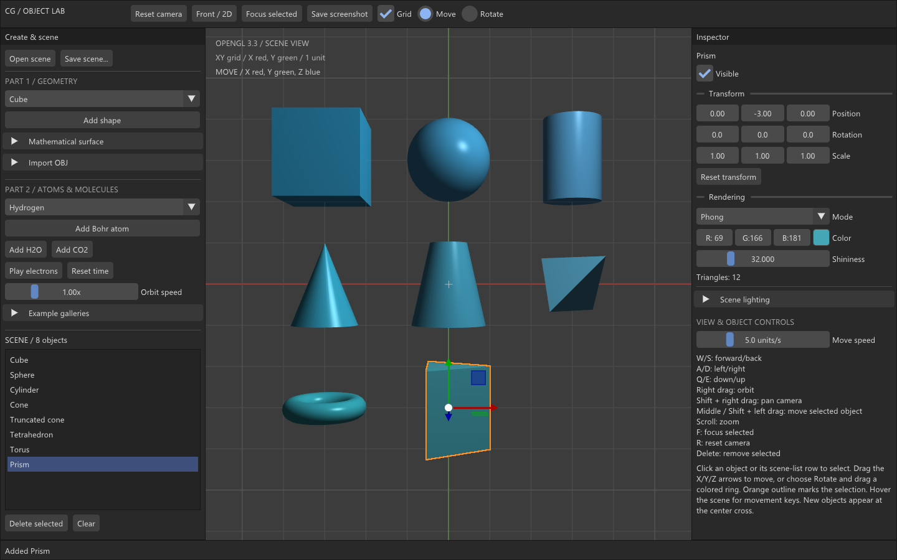

# Computer Graphics Assignments 1 and 2

Original Assignment 1 attribution: **Bùi Quốc Thái — 2353086**.
Assignment 2 team/author information for the final report has not yet been confirmed.

HCMUT · Computer Graphics (CO3059) · Semester I, 2026–2027

An interactive C++17 / OpenGL 3.3 Core application for 2D/3D geometry and synthetic
datasets: clean RGB, instance masks, visible bounding boxes, COCO labels, numerical
depth maps, metadata and seeded batch export. The original atom/molecule editor
is retained. All rendering uses VAOs, VBOs, EBOs, and GLSL.

Original Assignment 1 repository recorded in the supplied project:
<https://github.com/Funacius/ComputerGraphicsAssignment1>.
Assignment 2 repository:
<https://github.com/AtomTNB2202/CO3059-Assignment2-ComputerGraphic>.



## Build and run on Windows

Required: Windows 10/11, a GPU/driver supporting OpenGL 3.3, and Visual Studio
2022 or 2026 **Desktop development with C++** with the Windows SDK and **C++ CMake
tools for Windows**. VS Code is an editor; the Visual Studio Build Tools supply
the C++ compiler. Internet access is needed for the first configuration.

### Easiest option: PowerShell

From the project root in VS Code's terminal:

```powershell
powershell -NoProfile -ExecutionPolicy Bypass -File .\scripts\build.ps1 -Run
```

The script locates the installed compiler and bundled CMake, downloads pinned
dependencies, builds, and opens the application. It does not change the machine's
execution policy. On Visual Studio 2026 the executable is:

```text
out\build\vs18\Debug\ComputerGraphicsAssignment1.exe
```

For Visual Studio 2022, use `vs17` instead of `vs18`. To rebuild and run the tests:

```powershell
powershell -NoProfile -ExecutionPolicy Bypass -File .\scripts\build.ps1 -Test
```

For an optimized build, add `-Configuration Release`.

### VS Code CMake Tools

1. **File > Open Folder**: open `ComputerGraphicsAssignment1`.
2. Install Microsoft's **C/C++** and **CMake Tools** extensions if prompted.
3. Press **Ctrl+Shift+P**, run **CMake: Select a Kit**, and select a Visual Studio
   amd64/x64 compiler kit.
4. Run **CMake: Configure**. Wait for `Configuring done`, `Generating done`, and
   process exit code `0`. The initial dependency downloads can take a few minutes.
5. Run **CMake: Build** (or press **F7**).
6. Run **CMake: Set Debug Target**, select `ComputerGraphicsAssignment1`, then
   **CMake: Run Without Debugging**.

With the current Ninja configuration, you can also run:

```powershell
.\build\ComputerGraphicsAssignment1.exe
```

Build output paths depend on the selected generator. Visual Studio generators
place the executable inside a `Debug` or `Release` subfolder. The PowerShell
script prints the exact executable path.

References: [CMake Tools commands](https://github.com/microsoft/vscode-cmake-tools/blob/main/docs/how-to.md),
[MSVC in VS Code](https://code.visualstudio.com/docs/cpp/config-msvc).

### Full Visual Studio IDE

Use **File > Open > Folder**, wait for CMake configuration, choose x64 Debug,
select **Build > Build All**, select the executable startup item, and press
**Ctrl+F5**. No hand-written `.sln` or `.vcxproj` is needed.

## Features and usage

Assignment 2 adds **Export RGB + masks + COCO + depth** below the scene list.
It writes clean RGB, an exact 24-bit instance ID PNG, a color preview, binary
per-instance masks, a sample manifest, COCO annotations (visible bounding boxes,
class labels, compressed RLE masks), and `bbox_preview.png` into `dataset/` beside
the executable. It also writes `depth.npy` (float32 camera-forward depth in scene
units, background 0) and `depth_preview.png` (nearer is brighter). The sample
manifest records depth conventions, near/far planes and preview scaling.
The inspector exposes category ID/name, saved with the scene.
Older scenes infer categories from the OBJ filename stem or built-in object type.
See the Vietnamese guides for [milestone 1](docs/MILESTONE1_VI.md) and
[milestone 2](docs/MILESTONE2_VI.md), and [milestone 3](docs/MILESTONE3_VI.md),
including commands, code and manual checks.
Milestone 4 adds a **Batch generation** panel (sample count, seed, image dimensions
and variation switches/ranges). It exports merged COCO annotations, a dataset index,
camera/object/material metadata, base settings and replay scenes while preserving
the editor scene. Start with `assets/scenes/tabletop.json` (5 imported OBJ objects,
4 categories). See the [Vietnamese milestone 4 guide](docs/MILESTONE4_VI.md).
Command-line export is also available:
`ComputerGraphicsAssignment1.exe --export-scene scene.json NEW_output_directory`.
For a batch:
`ComputerGraphicsAssignment1.exe --export-batch scene.json NEW_output_directory settings.json`.
Example settings: `assets/configs/batch_demo.json`.

| Requirement | How to use it |
|---|---|
| Triangle, rectangle, pentagon, hexagon, circle, ellipse, trapezoid, star, arrow | Select a shape on the left, then **Add shape**; **Front / 2D** faces the XY plane |
| Cube, sphere, cylinder, cone, truncated cone, tetrahedron, torus, triangular prism | Same shape dropdown; use right drag to inspect the solid |
| User-defined `z=f(x,y)` | Expand **Mathematical surface**, enter a formula, choose domain/grid, then **Add surface** |
| OBJ import | Expand **Import OBJ**, use **Browse OBJ...**, then **Import model** (pasting a path also works) |
| Select, hide, delete | Click an object in the viewport or a scene-list row; the selection has an orange outline; click empty space to deselect |
| Translation and rotation | Select **Move** or **Rotate** in the toolbar, then left-drag an axis arrow or rotation ring; X is red, Y green, Z blue |
| Numeric transforms and scaling | Edit **Position**, **Rotation**, and **Scale** in the inspector |
| Five rendering modes | Choose **Flat color**, **Gouraud**, **Phong**, **Texture**, or **Wireframe** per object |
| External PNG/JPG | Choose Texture mode, use **Browse image...**, then **Load texture** |
| Bohr atoms | Choose H, He, C, N, O, or Ne and press **Add Bohr atom**; edit the element in the inspector |
| Molecules | Add H2O or CO2, then edit each atom's type and local XYZ coordinates |
| Electron animation | **Play electrons** / **Pause electrons**, **Orbit speed**, and **Reset time** on the left |
| Save and load | **Save scene...** writes JSON; **Open scene** restores it after confirming replacement |
| Screenshots | **Save screenshot** writes a PNG in `screenshots/` next to the executable |

New objects appear at the center cross, at the camera's current focus depth, and
may overlap. Move them with the inspector or selected-object dragging,
hide earlier objects, or use **Clear** before opening a gallery. Galleries add
objects without discarding the existing scene.

### Camera

| Input | Action |
|---|---|
| Right mouse drag in scene | Orbit |
| W / S (hover scene) | Move camera forward / backward |
| A / D (hover scene) | Move camera left / right |
| Q / E (hover scene) | Move camera down / up |
| Middle drag or Shift + left drag | Move only the selected object parallel to the screen |
| Shift + right drag | Pan camera |
| Mouse wheel | Zoom |
| R / Reset camera | Restore default view |
| F / Focus selected | Fit the whole selected object to the viewport, including rotation and scale |
| Front / 2D | Face the XY plane |
| Delete | Remove selected object |
| Escape | Close application |

Camera input is ignored while interacting with GUI controls or dragging a gizmo.
Viewport selection respects depth and visibility; wireframe objects are selectable
across their filled silhouette. The grid is not selectable.

The gizmo uses **world X/Y/Z axes** and rotates about the object's origin. Only the
selected object changes; its scale is preserved during rotation. For axes pointing
straight into the view, orbit the camera to expose the handle. The colored squares
in Move mode drag in an axis plane; the center drags parallel to the screen.

Object dragging requires a visible selection in front of the camera. It changes
the object's position, not the camera or other objects. For a molecule it moves
the whole selected molecule; edit an individual atom with its XYZ fields.
Dragging is locked to that selection until you release the mouse. Use the
inspector to change depth precisely, or orbit and drag from another angle.

The **Grid** checkbox toggles the reference grid: one-unit cells with stronger
lines every five units. The 3D floor is XZ (red X, blue Z); **Front / 2D** switches
to an XY grid (red X, green Y). The grid is a visual aid, not a selectable mesh.
Camera **Move speed** is adjustable in the inspector. WASD movement is relative
to the viewing direction; it translates the camera and its focus together.

### Surface expression syntax

Examples: `sin(x)*cos(y)`, `0.2*(x^2-y^2)`, `sqrt(abs(x*y))`.

- Variables: `x`, `y`; constants: `pi`, `e`.
- Operators: `+ - * / ^`, parentheses, unary signs. Multiplication must be explicit.
- Functions: `sin`, `cos`, `tan`, `sqrt`, `abs`, `exp`, `log` (natural logarithm).
- Exponentiation is right-associative: `2^3^2 = 512`; `-2^2 = -4`.
- The domain is `[-extent, extent]` on both axes, extent 0.1–10; grid 4–160 cells
  per axis. Expressions are limited to 256 characters and 64 nesting levels.
- A non-finite sampled height or absolute height over 10000 rejects the surface
  with an error. Finite discontinuities between samples are not automatically
  detected; choose a suitable domain for the function.

### Import and textures

The bundled `assets/models/pyramid.obj` and checker PNG/JPG are ready to test.
OBJ imports are centered and fitted into a two-unit bounding box. Missing normals
are generated per face; missing UVs use a simple planar projection. OBJ material
libraries are not imported: assign color/texture through the inspector. The file
limit is 50 MB and the triangle limit is one million. PNG/JPG textures are limited
to 8192 pixels per dimension and 100 MB encoded size.

Texture mode combines the image with the object's color and Phong illumination.
Set the color to white for neutral tint. **Checker** restores the built-in texture.

### Saving scenes

Scene JSON stores object types, surface formulas, transforms, materials, visibility,
edited molecules, camera, lighting, grid, and electron playback state. The limit is
256 objects / 8 MB of JSON. Loading an invalid scene or missing asset reports an
error and preserves the current scene. Save before closing; startup creates a new
default scene, which you can replace using **Open scene**.

External OBJ and texture files are referenced, **not embedded**. Paths are relative
to the scene file where possible. When moving a scene to another computer, include
these assets and preserve their relative folder structure. Canceling a file dialog
does not change the scene.

## Architecture

```text
src/main.cpp          Context creation and lifetime
src/core/             Application loop, camera, renderer, shader program
src/graphics/         GPU mesh, texture loading, OBJ import
src/shapes/           CPU mesh generation and expression parser
src/scene/            Object ownership, transforms, materials, selection
src/molecule/         Element data, molecule presets, bond transforms
src/gui/              Dear ImGui controls
include/              Public headers
shaders/              GLSL 330 vertex/fragment shaders
assets/               Sample textures and model
third_party/glad/     Generated OpenGL loader (included in source)
tests/                Geometry/math/import regression checks
scripts/              Windows build helper
docs/                 Study guide and demonstration checklist
report/               LaTeX source and compiled PDF
screenshots/          Captures from the graphics smoke test
```

CPU geometry uses indexed `MeshData`; `Mesh` uploads it once to OpenGL. An `Object`
owns transform/material data and references its mesh. Atoms and molecules reuse
sphere/cylinder meshes with local transforms. GLSL uses `P * V * M * position`
and inverse-transpose normals. GPU resources are destroyed before the context.

See [dependency versions/licenses](THIRD_PARTY.md) and the
[learning guide](docs/LEARNING_GUIDE.md) for a code-reading order and demo script.

## Tests

The build script's `-Test` option runs CTest:

- **annotations:** visible bounding boxes/area, exact COCO compressed RLE, one-pixel
  and clipped masks, invalid category mappings, merged image/annotation IDs and paths.

- **geometry:** all 17 shapes, triangle winding and polygon area, surface grid
  normals, arithmetic precedence and invalid expressions, OBJ import and malformed
  input, camera bounds, transforms, and bond endpoint alignment.
- **graphics_smoke:** starts a hidden OpenGL window, tests scene save/load and invalid
  files, depth-aware picking, hidden objects, resizing, focus bounds, and animated
  pixels. Injected ImGui mouse events exercise all three translation arrows and
  rotation rings, checking that scale, camera, and other objects stay unchanged.
  It renders seven demonstration scenes and saves screenshots. A working GPU is required.
  Dataset checks cover aligned RGB/ID/depth, planes at known depths, reproducible
  batch variation, pinned transforms, category mappings, saved instance IDs and
  editor restoration after batch export.

Tests do not automate every mouse/keyboard interaction. Use the manual checklist
in the learning guide before presenting the project.

## Report and submission

Start with [Assignment 2 readiness and demo checklist](docs/MILESTONE5_VI.md),
[demo script and questions](docs/DEMO_ASSIGNMENT2_VI.md), and
[implementation progress](docs/PROGRESS_ASSIGNMENT2.md).

The `report/` directory in the original checkout contains the **Assignment 1**
report. It is excluded from the draft Assignment 2 source archive. A final
Assignment 2 report has not yet been authored; both its English LaTeX source
and compiled PDF are still required for final submission.

Create a draft source package (without build caches or the original report):

```powershell
python scripts/package_assignment2.py --evidence output/milestone4/batch_seed42_a
```

The archive includes the 8-image evidence batch under `examples/dataset/` when
the command above is used. Scene/texture references in the copied evidence are
rebased to the included assets. See `SUBMISSION_STATUS.md` for pending items.
This is a **draft source package**, not a complete final submission. The final
Assignment 2 report is still pending. No LMS upload has been performed.

## Troubleshooting and boundaries

- **CMake/compiler not found:** use `scripts/build.ps1`, or enable the C++ workload,
  Windows SDK, and CMake component in Visual Studio Installer.
- **Download failure:** check internet access to GitHub and run Configure again.
- **Old console output:** rebuild the full CMake target; do not use a single-file
  "Run C++ File" or Code Runner command.
- **OpenGL context failure:** update the GPU driver. Remote sessions/VMs may not
  expose OpenGL 3.3.
- **Missing shader/texture:** build again and keep the generated `shaders/` and
  `assets/` folders beside the executable when moving it.
- **File error:** use a real file path without quotes. Invalid imports/expressions
  show a message in the status bar and leave existing objects intact.
- **Objects outside view:** reset/focus the camera, zoom out, or reset the transform.
- Save scenes explicitly before exit. PLY import, molecular vibration, undo/redo,
  YOLO export and tracking/captioning are not implemented. OBJ, COCO, depth and
  seeded static-scene dataset generation are implemented.
- Depth is camera-forward Z in scene units; its 8-bit preview is rescaled per sample.
- Annotation export currently selects COCO according to section 2.1's "COCO or
  YOLO" wording. Section 2.2 also lists both formats; YOLO is not implemented.
  Support libraries perform UI, loading and I/O; rendering/annotation logic is
  implemented in this project. See THIRD_PARTY.md for their roles and versions.
- Bohr and molecule sizes are illustrative, not a physical simulation; CO2 uses
  one cylinder per connected pair rather than a chemical bond-order depiction.
